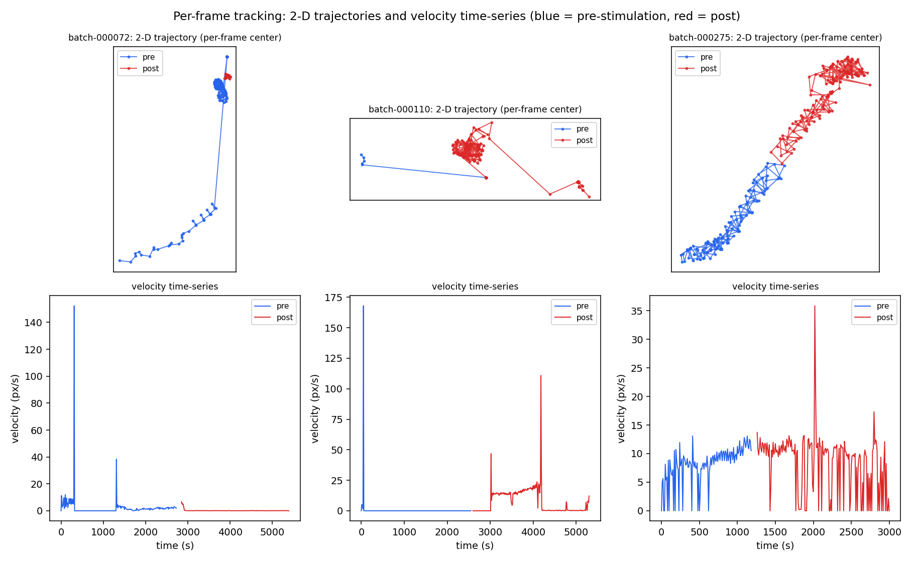

# xenobots_iclr2027

Code, data, and demo materials for "Toward Convincing Biology with Language: Offline Learning
of Prompt-Conditioned Interventions for Cells, Organoids, and Biobots" (ICLR 2027 submission).

## Contents

| path | description |
|---|---|
| `zapgpt_sequence.mp4` | Demo video of a stimulated xenobot sequence |
| `data/tracking_csv/` | **Per-frame tracking of all 163 archive batches** (full 2-D trajectories + velocity time-series; see below) |
| `scripts/compute_trajectory_shape_metrics.py` | Trajectory shape metrics (straightness, loop count) computed per experimental phase |
| `figures/example_trajectories.png` | Three example batches: 2-D trajectory + velocity time-series, pre- vs post-stimulation |

## Per-frame tracking data (`data/tracking_csv/`)

One CSV per experimental batch (`velocity_batch_XXXXXX.csv`), 163 batches total. Each batch is
one individually stimulated xenobot construct recorded through a three-phase protocol
(pre-stimulation baseline → electrical stimulation → post-stimulation observation). Tracking is
SAM-based (segment-anything segmentation with per-frame fallback strategies recorded in
`track_source`).

Columns:

| column | meaning |
|---|---|
| `batch_id` | batch identifier |
| `frame_index`, `timestamp` | frame number and time (seconds) |
| `phase` | `pre` / `during` / `post` (relative to electrical stimulation) |
| `center_x`, `center_y` | **per-frame 2-D position of the organism's tracked center (pixels)** — the full spatial trajectory |
| `bbox_x`, `bbox_y`, `bbox_w`, `bbox_h` | tracked bounding box |
| `displacement_pixels` | frame-to-frame displacement |
| `velocity_pixels_per_sec` | instantaneous speed |
| `tracking_success` | 1 if the tracker locked this frame (filter on this) |
| `track_source` | which tracking strategy produced this frame's fix |

So the archive contains not only scalar speed summaries but the **complete 2-D path of every
organism at every tracked frame**, in all three phases — enabling trajectory-shape analyses
(turning, circling, straightness) beyond the velocity-bucket behaviors used in the main paper.

## Trajectory shape metrics (`scripts/`)

`compute_trajectory_shape_metrics.py` computes, per phase, on the ordered
(`center_x`, `center_y`) points:

- **straightness** = net displacement / total path length ∈ (0, 1] (1 = perfectly straight);
- **loop count** = total absolute turning angle / 2π (≈ how many full rotations' worth of
  turning the path contains).

## Example

Blue = pre-stimulation baseline, red = post-stimulation. Left-to-right: a batch that stops, a
batch with a large transient swing, a batch that speeds up.

*(Additional training/evaluation code to be added.)*
